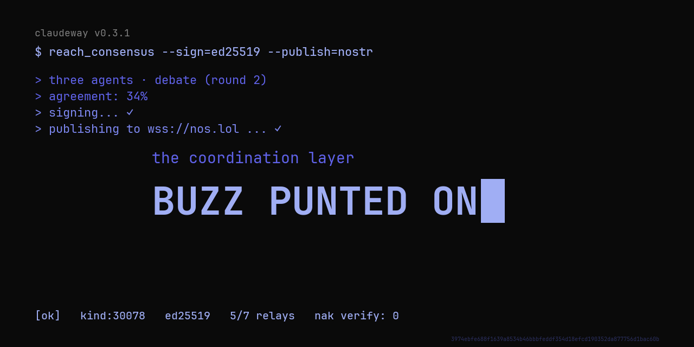

<p align="center">
  
</p>

# Claudeway

**Multi-agent consensus with cryptographic receipts.** Three agents debate, **each signs its own stance**, and the result ships as a k-of-n signed receipt anyone can verify — forever.

Every agent framework can make one agent answer. Most can run several in parallel. **None of them produce per-agent signed, quorum-verifiable artifacts you can hand to an auditor, a regulator, or a future teammate.** That's Claudeway.

> Frameworks coordinate. Claudeway agrees.

[](https://github.com/JordanNewell/claudeway/actions/workflows/ci.yml)
[](https://jordannewell.github.io/claudeway/)
[](https://www.python.org/downloads/)
[](#license)

---

## The receipt on the wire

Three Claudeway agents ran a real Debate consensus on *"what's the missing primitive for agent agreement?"* — signed the result with Ed25519, wrapped as a NIP-78 Nostr event, published to four public relays. Not a screenshot. Not a demo video. The actual cryptographically-signed artifact on the actual wire.

**View in any browser:** [nostr.mom/e/3974ebfe...](https://nostr.mom/e/3974ebfe688f1639a8534b46bbbfeddf354d18efcd190352da877756d1bac60b) — kind 30078 (NIP-78), BIP-340 signed.

**Verify the signature yourself** (event is on `wss://nos.lol`, `wss://offchain.pub`, `wss://relay.primal.net`, `wss://nostr.mom`):

```bash
# After fetching the event JSON from any relay above
# (or saving it from the viewer URL), verify the BIP-340 signature:
nak verify < claudeway-event.json && echo "sig valid"
# silent + exit 0 = signature valid
```

That's a Claudeway receipt, verifiable forever — on the same Nostr wire Buzz, Damus, Snort, and Primal speak.

---

## The 30-second pitch

```python
from claudeway import AgentConfig, Swarm, SwarmConfig, Task

swarm = Swarm(SwarmConfig(
    name="ArchReview",
    agents=[
        AgentConfig("StrongConsistency", "Distributed Systems Engineer", "..."),
        AgentConfig("Operations", "SRE / Platform Lead", "..."),
        AgentConfig("Pragmatist", "Staff Engineer", "..."),
    ],
), api_key=...)

result = await swarm.process(Task(
    id="q1",
    description="Active-active Postgres, FoundationDB, or eventual consistency for payments?",
    input_data={},
))

print(result.result["final_answer"])
print(f"agreement: {result.result['agreement']:.0%}  disagreed: {result.result['disagreed']}")
```

Three specialists. One signed answer. Disagreement **surfaced, not averaged away.**

## Why this exists

The agent-framework field is crowded but lopsided:

| Tool | What it solves | The gap |
|---|---|---|
| **LangGraph** ($1.25B) | Production orchestration, manual graphs | Coordination is DIY wiring |
| **CrewAI** | DX, fast prototyping | Coordination is shallow; +48% token cost |
| **Goose** (Block) | Single-agent harness + MCP | No multi-agent at all |
| **Buzz** (Block) | The *room* agents talk in | Coordination via workflows, no consensus primitive |
| **Anthropic SDK** | Base Claude calls | No coordination layer |
| **MCP marketplaces** | Tool distribution | No agreement primitive |

The whitespace, plain: *everyone built where agents act or where agents talk. Nobody shipped verifiable consensus — agreement with a tamper-evident receipt.* Claudeway fills exactly that.

## What makes it defensible

Consensus results aren't text — they're **signed, tamper-evident attestations** anyone can verify. And since v0.4.0, **each agent signs its own stance**: a Claudeway receipt is a k-of-n multi-sig over machine judgment, not one operator's claim about what the agents said.

```python
from claudeway import (
    ConsensusReceipt, Ed25519Backend, verify_receipt_detailed,
)

# Every agent in a Swarm gets its own signing keypair (pin real per-agent
# keys via AgentConfig.signing_key; otherwise ephemeral keys are
# provisioned per swarm). Each response carries a signature over that
# agent's stance — answer, confidence, model, role, task.

receipt = ConsensusReceipt.from_result(result, swarm_name="ArchReview", task_id="q1")
Ed25519Backend().sign_receipt(receipt, operator_key)

report = verify_receipt_detailed(
    receipt,
    expected_operator_pubkey=operator_pub,                        # pin the operator
    expected_agent_pubkeys={"A": pub_a, "B": pub_b, "C": pub_c},  # pin every agent
)
report.valid                    # aggregate signature valid AND quorum met
report.valid_statements         # how many agent signatures held up (k of n)
report.statements[2].reason     # "" | key-mismatch | task-id-mismatch
                                #    | response-mismatch:answer | ...
```

- **k-of-n quorum receipts** — the quorum threshold is part of the signed payload (a post-hoc downgrade is detectable); verifiers count valid agent signatures against it
- **Fabrication has a named defense** — a malicious operator can mint statements under fresh keys, but pinning per-agent keys catches it (`key-mismatch`); every statement is also cross-checked against the response it claims to attest (`response-mismatch:answer`) and pinned to its task (`task-id-mismatch`)
- **Ships with both Ed25519 and ML-DSA-65 backends** — switch with one kwarg. Ed25519 for speed and footprint; ML-DSA-65 (NIST level 3, FIPS 204) for attestations that must stay verifiable across the transition to cryptographically relevant quantum hardware
- **Same receipt, same canonical payload hash** — the SignatureBackend ABC isolates the crypto; consensus code is untouched either way
- **Three transports** — the same signed receipt renders as plain JSON, a W3C Verifiable Credential, or a **Nostr NIP-78 event** any Nostr client can read

This is the layer that makes consensus worth *acquiring* rather than reimplementing in a weekend.

## Nostr transport — verifiable end-to-end

The Nostr transport is exercised end-to-end against a reference relay:

```python
from claudeway.transports import to_nostr_event

event = to_nostr_event(receipt, private_key_hex=nostr_key, d_tag="room-42")
# event.kind == 30078 (NIP-78 addressable)
# event.sig is BIP-340 Schnorr over the sha256 of the NIP-01 serialization
# event.content carries the signed JSON receipt — any Nostr client decodes it
```

The event Claudeway produces verifies clean under [`nak`](https://github.com/fiatjaf/nak) (the reference Nostr CLI) and round-trips through `nak serve` — publish, subscribe, read back, receipt signature still verifies. See [`TESTLOG.md`](TESTLOG.md) for the four-layer evidence trail (BIP-340 KAT, 164-test suite, `nak verify`, end-to-end demo), [`examples/buzz_consensus_demo.py`](examples/buzz_consensus_demo.py) for the offline showcase, and [`examples/buzz_wire_publish.py`](examples/buzz_wire_publish.py) for the script that produced the **[live published v0.3.0 event](https://nostr.mom/e/3974ebfe688f1639a8534b46bbbfeddf354d18efcd190352da877756d1bac60b)** on five public relays.

## Install

```bash
pip install claudeway              # the SDK (4 deps, lean)
pip install claudeway[mcp]         # + expose consensus as an MCP server
pip install claudeway[nostr]       # + sign Nostr events for Buzz interop
pip install claudeway[pq]          # + ML-DSA-65 post-quantum signature backend
pip install claudeway[langgraph]   # + LangGraph StateGraph adapter
pip install claudeway[maf]         # + Microsoft Agent Framework adapter
pip install claudeway[crewai]      # + CrewAI @tool + Flow adapter
pip install claudeway[docs]        # + build the docs site locally
```

## Use it three ways

### 1. As a Python SDK

```python
from claudeway import Swarm, WeightedVote, Debate

# Cheap default — one round, picks highest-confidence answer
swarm = Swarm(config, consensus=WeightedVote())

# For hard questions — agents see peers' answers and revise once
swarm = Swarm(config, consensus=Debate())
```

### 2. As an MCP server (any agent can call consensus)

```bash
claudeway-mcp            # stdio — for Claude Code, Cursor
claudeway-mcp --http     # HTTP/SSE — for remote agents
```

Now any MCP-capable agent (Claude Code, Cursor, Goose) gains two tools: `reach_consensus` and `verify_consensus`. One tool call gets a signed agreement — no framework to learn, no graphs to wire.

### 3. As a coordinator (hierarchical decomposition)

```python
from claudeway import Coordinator, CoordinatorConfig

coord = Coordinator(CoordinatorConfig())
coord.add_sub_agent("Researcher", ...)
coord.add_sub_agent("Analyst", ...)
result = await coord.coordinate(task)
# The coordinator's plan is parsed for real, specialists run in dependency
# order (parallel where independent), results synthesized.
```

## Examples

- [`examples/quickstart.py`](examples/quickstart.py) — 15 lines, 3 agents → signed receipt
- [`examples/consensus_demo.py`](examples/consensus_demo.py) — disagreement surfaced, then resolved via Debate
- [`examples/coordinator_demo.py`](examples/coordinator_demo.py) — real decomposition + parallel specialists
- [`examples/buzz_consensus_demo.py`](examples/buzz_consensus_demo.py) — **Buzz adapter**: 3 agents → signed consensus → live Nostr relay → read back + verified
- [`examples/buzz_wire_publish.py`](examples/buzz_wire_publish.py) — publishes a signed NIP-78 event to public relays
- [`examples/langgraph_adapter_demo.py`](examples/langgraph_adapter_demo.py) / [`maf_adapter_demo.py`](examples/maf_adapter_demo.py) / [`crewai_adapter_demo.py`](examples/crewai_adapter_demo.py) — the three framework adapters
- [`examples/transparency_demo.py`](examples/transparency_demo.py) — append-only transparency log anchored to Nostr
- [`examples/killer_demo.py`](examples/killer_demo.py) — the blind-judge benchmark (Claudeway vs CrewAI vs single Claude); reproducible via the Docker compose appliance

## Repository layout

```
claudeway/          # the SDK package (wheel contents) — swarm, consensus, signing, transports, server (MCP), adapters
api/                # FastAPI runner/control plane (platform features deprecated; see docs/DEPRECATION.md)
dashboard/          # Next.js dashboard frontend for the runner
tests/              # pytest suite (consensus, coordinator, signing, nostr, adversarial, adapters)
examples/           # runnable demos (above)
benchmarks/         # benchmark Dockerfile + run.sh
docs/               # mkdocs sources (ARCHITECTURE, CHANGELOG, DEPRECATION, ...)
scripts/ infra/     # supporting tooling
```

## Features

- **Real consensus** — `WeightedVote` (cheap, default) and `Debate` (revision round when agents disagree, early-exits when they already agree)
- **Real decomposition** — JSON plan parsing, dependency-respecting parallel execution, specialist routing
- **Concurrent** — N-agent swarms issue all Claude calls in parallel, not serially
- **Verifiable** — every result is a signed, tamper-evident receipt; every agent's stance is individually signed and quorum-countable
- **MCP-native** — ships as an MCP server for the 10K+ server / 8M-downloads/month ecosystem
- **Claude-native** — built on the Anthropic SDK, prompt-caching-friendly
- **Lean** — 4 base dependencies

## Architecture

```
┌─────────────────────────────────────────────┐
│  Transports (claudeway.transports)          │
│  JSON receipt · W3C VC · Nostr NIP-78 event │
└──────────────────┬──────────────────────────┘
                   │ carries
┌──────────────────▼──────────────────────────┐
│  Signing (claudeway.signing)                │
│  ConsensusReceipt · Ed25519Backend · (PQ)   │  ← the moat
└──────────────────┬──────────────────────────┘
                   │ signs
┌──────────────────▼──────────────────────────┐
│  Consensus (claudeway.consensus)            │
│  WeightedVote · Debate · (your strategy)    │
└──────────────────┬──────────────────────────┘
                   │ aggregates
┌──────────────────▼──────────────────────────┐
│  Core (claudeway.swarm/coordinator/agent)   │
│  Swarm · Coordinator · Runtime · Tools/MCP  │
└─────────────────────────────────────────────┘
```

See [`docs/ARCHITECTURE.md`](docs/ARCHITECTURE.md) for the full design.

## Roadmap

**Shipped (v0.2.0):**
- SDK (Swarm, Coordinator, Agent) with real concurrent execution
- WeightedVote + Debate consensus strategies with cost-guarded early-exit
- Signed receipts with the swappable `SignatureBackend` ABC and an **Ed25519** default backend
- Three transports: JSON receipt, W3C Verifiable Credential, Nostr NIP-78 event
- MCP server (`claudeway-mcp`) exposing `reach_consensus` + `verify_consensus`
- **Buzz adapter** — verifiable end-to-end against `nak serve`

**Shipped (v0.3.0):**
- **Post-quantum signature backend** — **ML-DSA-65** (FIPS 204), pure-Python via `dilithium-py`. Same receipt, same canonical hash; swap in at the `SignatureBackend` ABC.
- **LangGraph adapter** — Claudeway consensus as a single `StateGraph` node
- **Microsoft Agent Framework adapter** — Claudeway as a workflow + agent in MAF (AutoGen + Semantic Kernel successor)
- **CrewAI adapter** — Claudeway as a `@tool` and Flow; inverts the killer demo so a CrewAI crew can *call* Claudeway for agreement
- **Consensus transparency log** — RFC 6962-style append-only log, anchored to Nostr on a cadence
- **Streaming consensus events** — `OnEvent` callback surfaces `AgentCompleted` and `ConsensusResolved` events as they happen
- **Killer benchmark** — Claudeway beats single Claude (+7/20) and CrewAI (+5/20) on a hard question, blind-judge scored, Mann-Whitney U
- **Adversarial security suite** — 20 tests across 7 attack classes + published threat model
- **Docs site** — jordannewell.github.io/claudeway (mkdocs-material + mkdocstrings)
- Tolerant structured-output parser, substantive `<answer>` contract
- Stable signing key across adapter runs, async→sync bridge deadlock fix

**Shipped (v0.4.0):**
- **Per-agent signed statements + k-of-n quorum receipts** — each agent signs its own stance; receipts carry every agent's individual signature plus a signed quorum threshold, upgradeable from "operator's claim" to "countable multi-sig"
- **`verify_receipt_detailed`** — full verification report: aggregate signature, per-statement signatures, statement/response cross-checks, operator + per-agent key pinning, quorum count
- **MCP `verify_consensus` upgrade** — the tool now returns the full statement-by-statement verdict

**Next:**
- A2A (Agent-to-Agent) protocol adapter — verifiable consensus for Google's agent protocol
- W3C VC presentation exchange flow
- Single-tenant runner — FastAPI + SQLite + dashboard, `docker compose up`

**Deliberately deferred (the "Curtis lesson" — don't build before there's demand):**
- Multi-tenancy, billing, Stripe, template marketplace. Re-activated only when paying demand appears. See [`docs/DEPRECATION.md`](docs/DEPRECATION.md).

## Docs

Full documentation at **[jordannewell.github.io/claudeway](https://jordannewell.github.io/claudeway/)**:

- [Transports](https://jordannewell.github.io/claudeway/transports/) — JSON vs W3C VC vs Nostr NIP-78, and when to pick each
- [Adapters](https://jordannewell.github.io/claudeway/adapters/) — Buzz and LangGraph integration paths
- [Benchmarks](https://jordannewell.github.io/claudeway/benchmarks/) — Claudeway vs single Claude vs CrewAI
- [API reference](https://jordannewell.github.io/claudeway/api-reference/) — auto-generated from the source
- [Changelog](https://jordannewell.github.io/claudeway/CHANGELOG/)

The docs site deploys automatically on push to `main` via the
[`docs.yml`](.github/workflows/docs.yml) workflow. Build locally:

```bash
pip install -e ".[docs]"
mkdocs serve          # http://127.0.0.1:8000
```

## Contributing

- [CONTRIBUTING.md](CONTRIBUTING.md) — branch model, commit rules, test commands, how to add docs
- [SECURITY.md](SECURITY.md) — private vulnerability reporting process and SLA
- [CODE_OF_CONDUCT.md](CODE_OF_CONDUCT.md) — Contributor Covenant 2.1
- Bug reports and feature requests: use the [issue templates](https://github.com/JordanNewell/claudeway/issues/new/choose)

## Development

```bash
pip install -e ".[mcp,nostr,pq,dev]"
pytest tests/ -v          # 187 tests (set CLAUDEWAY_TEST_RELAY=ws://localhost:10547 to exercise the relay integration test)
ruff check claudeway/ tests/ examples/
```

## NEWELL

*A [NEWELL](https://github.com/JordanNewell) project · maintained by Jordan Newell*

- Site: [jordannewell.com](https://jordannewell.com)
- GitHub: [@JordanNewell](https://github.com/JordanNewell)
- Project docs: [jordannewell.github.io/claudeway](https://jordannewell.github.io/claudeway/)

For acquisition, partnership, integration, or "we're Block and we want to talk" — open a [private security advisory](https://github.com/JordanNewell/claudeway/security/advisories/new) (it routes to my email) or email `jordan` @ `jordannewell.com`.

## License

Licensed under the Business Source License 1.1 (BUSL-1.1) — source-available; converts to MIT on 2030-10-12. See [LICENSE](LICENSE).


<p align="right">
  <a href="https://jordannewell.com" title="Built by Jordan Newell">
    
  </a>
</p>